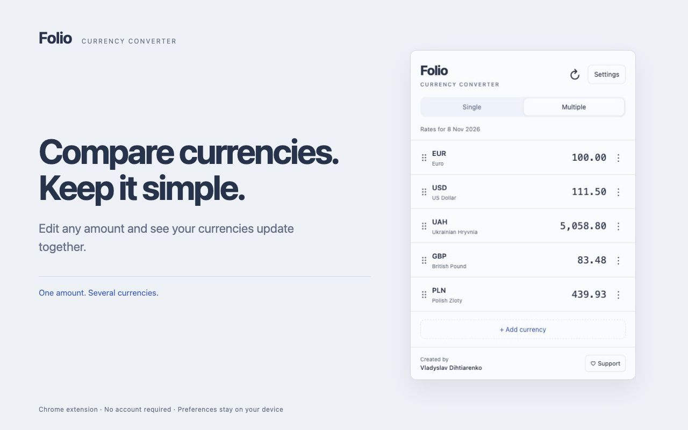

# Folio: Currency Converter

<p align="center">
  
</p>

<p align="center">
  
</p>

[Open Folio in the Chrome Web Store](https://chromewebstore.google.com/detail/folio-currency-converter/ipalahidibcjajbjbcdjphamlbhneomn)

Folio is a Chrome extension for converting an amount into one or several currencies. It opens from the toolbar and saves your currency list, amounts, settings, and last valid rates on your device.

- **Single mode** shows a currency pair. Edit either amount or swap the currencies.
- **Multiple mode** shows a list of currencies. Edit any amount to recalculate the others, then add, replace, remove, or reorder rows.
- **Display settings** include English, Russian, Ukrainian, Spanish, Brazilian Portuguese, French, German, and Hindi interfaces, light and dark themes, compact rows, and adjustable precision, names, symbols, and flags.

Rates come from [exchange-api](https://github.com/fawazahmed0/exchange-api), which publishes daily data. Folio offers every code in the validated response, including cryptocurrencies, metals, and historical currencies. The first successful download requires an internet connection. After that, saved rates remain available offline.

## Project structure

The source is grouped by capability. Tests sit beside the code they check.

```text
folio-currency-converter/
├── src/
│   ├── App.tsx                  # Connects providers and interface sections
│   ├── main.tsx                 # Starts the application
│   ├── Header.tsx               # Heading and settings control
│   ├── Footer.tsx               # Footer links and author information
│   ├── branding.ts              # Author, feedback email, and support address
│   ├── styles.css               # Shared colors, sizes, and interface styles
│   ├── converter/
│   │   ├── amounts.ts           # Conversion calculations
│   │   ├── useConverter.ts      # Converter actions
│   │   ├── SingleConverter.tsx  # Currency pair interface
│   │   ├── MultipleConverter.tsx # Currency list and row ordering
│   │   ├── currency/            # Currency labels, catalog, and search
│   │   └── money-input/         # Editable amounts and number formatting
│   ├── rates/                   # Fetching, validating, and refreshing rates
│   ├── storage/                 # Validating, restoring, and saving local data
│   ├── settings/                # Settings model, controls, and dialog
│   ├── notifications/           # Notifications and removal undo
│   └── i18n/                    # Translations and language selection
├── public/
│   ├── manifest.json            # Chrome extension settings and permissions
│   ├── _locales/                # Extension names and descriptions for Chrome
│   └── icons/                   # Toolbar and extension icons
├── patches/                     # Ariakit compatibility fixes for Preact
├── .vscode/                     # Shared Cursor and VS Code editor settings
├── .husky/pre-commit            # Runs code checks and tests before a commit
├── biome.jsonc                  # Formatting, lint rules, and import sorting
├── vite.config.ts              # Development, test, and build configuration
├── pnpm-workspace.yaml          # Dependency patches and allowed build scripts
├── package.json                 # Dependencies and development commands
└── AGENTS.md                    # Instructions for coding agents
```

`dist/` is generated by the build and contains the files Chrome loads. Change the source files and rebuild rather than editing `dist/`.

## Run locally

Install Node.js 22.12 or later and pnpm, the package manager used by this project. In the project folder, run:

```sh
pnpm install
pnpm dev
```

Open the address printed by Vite, the development server and build tool. It is usually [http://127.0.0.1:5173](http://127.0.0.1:5173). This opens a browser preview in a regular tab.

Installation also applies the dependency patches in `patches/`. No account or environment variables are required.

## Install in Chrome

After installing dependencies, create the extension files:

```sh
pnpm build
```

1. Open `chrome://extensions` in Chrome.
2. Turn on **Developer mode**.
3. Click **Load unpacked** and select the project's `dist` folder.
4. Pin Folio to the toolbar and click its extension button.

After changing the source, run `pnpm build` again, click **Reload** on the extension card, and reopen the popup.

The installed extension uses `chrome.storage.local`, Chrome's local extension storage. The browser preview uses `localStorage`, storage tied to the preview's website address. These stores are separate, and Folio does not synchronize data between devices.

## Use Folio

### Enter amounts

Click an amount and type. A valid edit immediately recalculates the other fields in either mode. The active input is highlighted while it has focus.

Thousands separators remain visible as you type. The period and comma keys enter the decimal separator used by the selected language and region. When pasting, use that format: for example, `1,234.50` in English or `1 234,50` in Russian.

Amounts allow up to 12 digits before the decimal separator and 8 after it. Fractional digits and a trailing separator remain while editing. Display rounding applies when you leave the field.

An invalid amount has a red background and a left stripe, with a description available to screen readers. Other fields keep the last valid calculation. Press Escape to cancel the invalid draft, or enter a valid amount in another field to replace it with a calculated value.

### Choose and reorder currencies

In Multiple mode, use the row's action menu to replace, remove, or move a currency. You can also reorder rows using their drag handles. Removing a row shows **Undo**.

The currency picker supports these searches:

- Currency codes and names, such as `USD` or `euro`.
- Country names in English, Russian, Ukrainian, Croatian, and the interface language, including aliases such as USA, UK, and UAE.
- Language and region codes, such as `en-US`, `uk-UA`, or `hr-HR`.

Use the arrow keys to select a result, Enter to confirm, and Escape to close the picker. Results update after a short pause in typing, with exact currency codes ranked first.

Before you search, popular currencies appear first. These include the currency associated with the browser's first explicitly specified region, when available. Changing Folio's interface language does not change that region. Other currencies are grouped by type, such as national currencies, cryptocurrencies, metals, and historical currencies.

An unfamiliar code from the source is still available even if Folio has no name for it. Cryptocurrencies and metals never receive country flags.

### Adjust settings and notifications

Settings apply immediately. The display controls share one live preview showing names, symbols, flags, precision, and compactness.

**Browser default** follows the browser's language preferences and uses its first locale, the language and region setting, for numbers and dates. Unsupported interface languages fall back to English. Selecting a supported language changes the popup's interface, subtitle, and document title. Chrome chooses the extension name, description, and toolbar tooltip separately using its own interface language.

Flags are decorative hints. For example, EUR uses the EU flag and USD uses the US flag. They do not represent every country using a currency, and their appearance depends on the operating system.

Folio shows one notification at a time. Ordinary messages disappear after five seconds; hovering over a message or focusing a control inside it pauses the timer. **Undo** remains until you use it, dismiss it, or another action replaces it. Notifications do not take keyboard focus. Storage errors stay visible near the affected interface.

Settings also include a feedback email link and a Support link. The support address is configured in `src/branding.ts`.

## Development commands

Biome handles formatting, linting, and import sorting. Formatting controls indentation, spacing, and line wrapping. Linting checks for code problems, such as unused variables. TypeScript checks that values and function calls match their declared types.

| Command             | What it does                                                                             | Changes files? |
| ------------------- | ---------------------------------------------------------------------------------------- | -------------- |
| `pnpm dev`          | Starts the browser preview with updates when source files change                         | No             |
| `pnpm check`        | Checks formatting, lint rules, and import order, then TypeScript types if Biome passes   | No             |
| `pnpm check:fix`    | Applies formatting, import sorting, and safe lint fixes; does not check TypeScript types | Yes            |
| `pnpm format`       | Applies formatting only                                                                  | Yes            |
| `pnpm format:check` | Checks formatting only                                                                   | No             |
| `pnpm lint`         | Checks lint rules only                                                                   | No             |
| `pnpm imports`      | Sorts imports only                                                                       | Yes            |
| `pnpm test`         | Runs the automated tests once                                                            | No             |
| `pnpm build`        | Checks TypeScript types and generates the extension in `dist/`                           | Writes `dist/` |

Use `pnpm check:fix` when you want formatting, import sorting, and safe fixes together. Then run `pnpm check` to catch remaining problems and check types. A successful `pnpm check` already covers the narrower lint and formatting checks.

For formatting on save in Cursor or VS Code, install the recommended Biome extension. The shared `.vscode/settings.json` selects it for the project's source and configuration formats. Saving and terminal commands use the same Biome configuration. Biome removes trailing commas from JSON and JSONC, including `biome.jsonc`, even though the editor allows them when validating that file.

Import sorting uses Biome's default order and preserves boundaries created by side-effect imports, such as CSS imports that load styles. The project does not use separate ESLint or Prettier tools.

## How it works

### Interface and compatibility

Preact 11 renders the interface, and TypeScript provides type checking. Ariakit supplies accessible dialogs, menus, search fields, selects, radio buttons, and checkboxes. Framer Motion animates mode changes, settings, notifications, and row dragging, respecting the system's reduced motion setting.

Ariakit and Framer Motion use React interfaces. The Preact Vite preset redirects their React imports to `preact/compat`, Preact's compatibility layer. React type definitions remain for development, while the built extension uses Preact. Vite also redirects Ariakit's external-store subscription hook, which listens for changes in shared state, to Preact's implementation in both builds and tests.

Two local Ariakit patches are required by the installed versions:

- `@ariakit/react-utils@0.2.8` uses Preact's effect event hook to make callbacks available when element references attach, before layout effects run.
- `@ariakit/react-components@0.7.1` handles native events with a read-only `currentTarget` and preserves keyboard fields when forwarding events to the active option. This keeps focus handling and Enter confirmation working.

`pnpm install` applies these patches through `pnpm-workspace.yaml`. Recheck them when updating Ariakit or Preact. Framer Motion is unpatched. Its `LayoutGroup` measures currency rows together before Preact moves their elements, keeping drag positions consistent.

### Calculations and saved state

`useConverter` coordinates actions, and `src/converter/amounts.ts` owns conversion rules. Both modes share one amount stored in euros. The source supplies USD-based rates, so a conversion uses their ratio. For example, one euro in hryvnias is `usd.uah / usd.eur`.

Editing amounts and changing currencies use the loaded rates without making network requests. Precision settings affect displayed values. Calculations use ordinary JavaScript numbers and are unsuitable for accounting that requires guaranteed cent-level precision.

`SavedStateProvider` shares one state store per popup document. `restoreState` validates saved data and supplies safe defaults for damaged or missing fields. The storage key remains `folio.state.v1`, including for older saves containing only 12 currencies.

The extension waits for its asynchronous storage read before allowing edits, then saves changes in order. The browser preview reads `localStorage` synchronously. Remounting the interface in the same document reuses loaded state and pending writes; reopening the extension creates a new document and reads storage again.

Components use `useSavedState` to subscribe to the values they need. Each selector, a function choosing part of the saved state, must return a primitive value or an existing stable reference such as `state.settings`. Creating a new object on every call breaks that stability. Separate contexts share converter actions, input feedback, picker state, and notifications with the components that need them.

### Rate updates and offline use

Folio requests rates only from:

```text
https://latest.currency-api.pages.dev/v1/currencies/usd.json
```

After restoring saved data, Folio shows the last validated snapshot, a complete set of rates and its source date, and checks for an update. The refresh button starts the same check. Only one request runs at a time; completed requests have no waiting period before another manual check. Requests time out after 15 seconds, with no automatic retry.

A check can confirm that existing data is still current. It does not necessarily receive new rates. The browser handles HTTP caching, reusing a downloaded response after checking it with the server. The displayed date comes from the source data, not the time of the check.

A response replaces the saved snapshot only after validation. USD must equal 1, EUR must be present, and every rate must be a finite positive number. If the response is invalid, the request fails, or a selected currency is missing, Folio keeps the previous snapshot. It saves no rate history and uses no fallback source or backend.

Without a saved snapshot, calculations remain unavailable until the first successful download. While storage or the first rates are loading, placeholders match the selected converter mode. With saved rates available, refreshes keep the existing amounts visible.

### Extension permissions and privacy

`public/manifest.json` uses Manifest V3, Chrome's current extension configuration format. It requests local storage and access to `https://latest.currency-api.pages.dev/*` for rates. Its security policy restricts connections to that source and blocks external scripts.

Folio has no background process, analytics, or code injected into websites. Rate requests do not include entered amounts, settings, or selected currencies.

### Production build

Vite creates the extension files, and Terser reduces JavaScript size using two compression passes. Production builds do not include source maps, files that connect generated code to its original source.

For historical context, the November 4, 2026 Preact migration reduced the main JavaScript file from 573.54 kB to 374.58 kB under the same build settings. That measurement was below Vite's 500 kB warning threshold. Use the output of a fresh `pnpm build` for the current size and warnings.

## Verify changes

After changing application code, run:

```sh
pnpm check
pnpm test
pnpm build
```

Vitest runs the automated tests for calculations, input handling, rates, localization, notifications, and storage. Some interface tests use Happy DOM, a simulated browser environment. The language-setting test checks Ariakit focus events and keyboard confirmation with Preact.

For interface changes, also check:

- Single and Multiple modes, including valid and invalid amount edits.
- Keyboard navigation, Escape, outside-click dismissal, and focus return after closing menus and dialogs.
- Currency search, reordering, removal, and Undo.
- Light and dark themes, narrow popup dimensions, and reduced motion.
- Settings and amounts after reloading.

Use the built-in Codex browser for preview checks when working in Codex. A regular browser preview does not verify the installed Chrome extension: test the built popup in Chrome separately. Previous compatibility checks recorded for this project covered the browser preview, including the interactions listed above; they did not establish installed-extension compatibility.

A minimum Chrome version has not been verified for the complete extension. The automated commands do not enforce browser compatibility. Biome's `useBaseline` rule is disabled because it checks support across several browsers rather than a selected Chrome version. Empty CSS files and duplicate selectors are errors. Review any unused-class warnings before removing styles, since dynamically assembled class names can be missed by automated checks.

## Extend Folio

Keep each change with the capability that owns it:

- **Currencies:** new codes from a validated response become available automatically. Add missing names in `src/converter/currency/currencyNames.ts`, and symbols or decorative flags in `src/converter/currency/currencies.ts`. Older 12-currency saves gain the full list after a successful refresh. Do not assign country flags to cryptocurrencies or metals.
- **Interface text:** update the English, Russian, and Ukrainian dictionaries in `src/i18n/messages.ts` and the Spanish, Portuguese, French, German, and Hindi dictionaries in `src/i18n/<language>/messages.ts`. Chrome's extension name and description are separate, in `public/_locales/<language>/messages.json`.
- **Settings:** define them in `src/settings/model.ts` and validate them in `src/storage/model.ts`. Give older saves defaults that preserve existing preferences.
- **Conversion rules:** use `src/converter/amounts.ts` and add focused calculation tests. Keep editable text formatting in `src/converter/money-input/`.
- **Persistence:** keep reads, validation, and ordered writes in `src/storage/`. Preserve `folio.state.v1` unless implementing a compatible migration.

Read `AGENTS.md` before making changes. Prefer installed libraries over new dependencies, keep calculations and persistence separate from interface components, and retain the last valid rates when a refresh fails.
